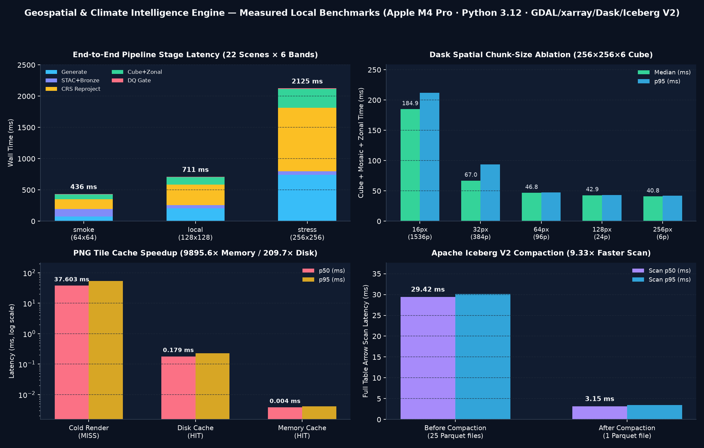
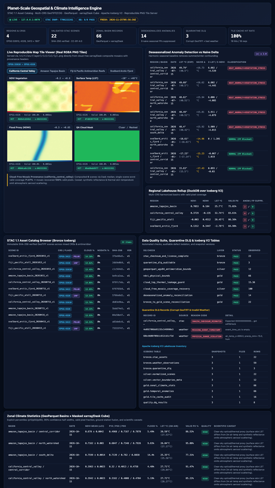

# Technical Appendix — Ablations, Chaos Drills & Acceptance Matrix

This appendix holds all deep optimization progressions, raw ablation tables, fault-injection drill results, full visual artifacts, and the 15-point acceptance-test verification matrix backing the headline summary in [README.md](README.md).

## Benchmark Visualization

## Dask Spatial Chunk-Size Ablation

Measured on the `amazon_tapajos_basin` `256 × 256 × 6` spatiotemporal cube (5 iterations per configuration, isolating xarray/Dask cube construction, cloud-free median compositing, and GeoParquet basin zonal aggregation after pre-reprojection).

| Chunk Size (px) | Dask Partitions | Median Time (ms) | p95 Time (ms) | Speedup vs. 16px Baseline | Mean NDVI Parity Check | Delta vs. Baseline |
| ---: | ---: | ---: | ---: | ---: | ---: | ---: |
| `16` | 1,536 | 184.91 | 212.09 | 1.00× (baseline) | `0.705089` | `0.0` |
| `32` | 384 | 66.97 | 93.89 | 2.76× faster | `0.705089` | `0.0` |
| `64` | 96 | 46.83 | 47.26 | 3.95× faster | `0.705089` | `0.0` |
| `128` | 24 | 42.94 | 43.29 | 4.31× faster | `0.705089` | `0.0` |
| **`256`** | **6** | **40.84** | **41.92** | **4.53× faster** | `0.705089` | `0.0` |

**Engineering Takeaway:** Over-chunking a `256 × 256` scene into `16 × 16` blocks generates 1,536 Dask tasks whose scheduler overhead dominates actual NumPy compute by more than `4.5×`. In production on full 10,980 × 10,980 Sentinel-2 tiles, `512 × 512` chunks balance bounded worker memory against task-graph overhead; locally, `64–256px` chunks keep compute fast with zero numerical drift (`parity_delta = 0.0`).

## Reproducible Map Tile Cache Tier Study

Measured across 4 study regions × 4 layers (`ndvi`, `lst`, `flood`, `qa`) × 2 pyramid coordinates (`32` cold renders, `32` disk-cache reads after fresh server instantiation, `64` in-memory cache hits).

| Cache Tier | Samples | p50 (ms) | p95 (ms) | p99 (ms) | Speedup vs. Cold Render | Persistence Across Restart |
| --- | ---: | ---: | ---: | ---: | ---: | :---: |
| Cold Render (`MISS`: GDAL read + colormap + Pillow PNG) | 32 | 37.603 | 53.403 | 53.816 | 1.0× (baseline) | Writes disk cache |
| Disk-Warm Cache (`HIT`: disk PNG + meta read) | 32 | **0.179** | **0.225** | — | **209.7× faster** | Yes |
| Memory-Warm Cache (`HIT`: in-process bytes) | 64 | **0.0038** | **0.0041** | **0.0057** | **9,895.6× faster** | Re-hydrated from disk |

## Apache Iceberg V2 Compaction Study

Simulated 24 incremental micro-batch appends to `gold.zonal_climate_stats` (`25` fragmented Parquet data files, `354` total rows), followed by atomic `compact_table()` coalescing down to `1` Parquet file. Scan latency measured across 20 full Arrow table reads before and after compaction.

| State | Parquet Data Files | Rows Preserved | Scan p50 (ms) | Scan p95 (ms) | Speedup vs. Fragmented |
| --- | ---: | ---: | ---: | ---: | ---: |
| Before Compaction | 25 | 354 | 29.42 | 30.10 | 1.00× (baseline) |
| After Compaction (`86.40 ms` rewrite) | **1** | **354** | **3.15** | **3.51** | **9.33× faster** |

## Automated Chaos & Fault-Injection Drills (8/8 PASS)

Raw structured output persisted in [results/chaos/chaos_results.json](results/chaos/chaos_results.json).

| Drill ID | Failure Injected | Observed Recovery & Assertion | Duration (ms) | Status |
| --- | --- | --- | ---: | :---: |
| `drill_01` | Corrupt GeoTIFF bytes + bad SHA-256 | Quarantined to `bronze.quarantine_dlq` (`SHA256_CHECKSUM_MISMATCH`); 22 healthy scenes preserved | 773.7 | PASS |
| `drill_02` | Mixed CRSs (`32610`, `3413`, `4326`) | All scenes normalized to canonical `EPSG:4326`; max round-trip error `0.0 m` (`< 0.01 m`) | 786.1 | PASS |
| `drill_03` | Heavy tropical cloud (`18.73%` valid px) | Zero `-31 °C` cloud-top thermal leakage (min zonal LST `15.36 °C`); Dask median mosaic recovered `100.0%` | 735.3 | PASS |
| `drill_04` | 180° Antimeridian Fiji & 78°N Svalbard | Fiji split into 3 valid `MultiPolygon` basins (`[-180, 180]`); 15/15 Fiji & 15/15 Polar zonal rows valid | 762.8 | PASS |
| `drill_05` | 2/9 spatial tile I/O failures injected | 7/9 healthy tiles computed bit-exact values; 2 failed tiles isolated with explicit bounds & error metadata | 0.2 | PASS |
| `drill_06` | Idempotent incremental backfill replay | Exact 66/66 row and zonal-value parity across multiple Iceberg V2 snapshots | 1,625.5 | PASS |
| `drill_07` | v2 radiometric calibration backfill | Invalidated v1 tile cache, advanced `X-Scene-Version: 1 -> 2`, issued new `ETag`, re-cached as `HIT` | 2,175.8 | PASS |
| `drill_08` | Cold API + Iceberg process restart | Reloaded all 9 Iceberg V2 tables, STAC catalog, and disk-backed PNG tile cache (`HIT` on first request) | 1,249.6 | PASS |

## Full-Page Geospatial Control Tower Capture

## 15-Point Mandatory Acceptance-Test Matrix

| # | Acceptance Criterion | Status | Verification Command / Artifact |
| :-: | --- | :---: | --- |
| 1 | Fresh-clone setup starts core stack & verifies health | PASS | `./scripts/run_portable.sh` + `GET /health -> 200 OK` |
| 2 | Deterministic seed produces identical IDs & outcomes | PASS | `pytest tests/integration/test_iceberg_and_pipeline.py::test_deterministic_seed_produces_identical_stac_ids_and_zonal_means` |
| 3 | Real ingestion persists source data + metadata + replay | PASS | `bronze.stac_assets`, `bronze.weather_observations`, `pystac` `catalog.json` |
| 4 | Core domain transform yields correct results on fixtures | PASS | `pytest tests/unit/test_climate_analytics.py tests/unit/test_crs_and_geometry.py` |
| 5 | Domain advanced features operational end-to-end | PASS | Mixed-CRS reprojection, 180° split, xarray/Dask mosaics, deseasonalized z-scores, PNG tiles (`tests/e2e/`) |
| 6 | Duplicates, late corrections & retractions handled cleanly | PASS | `reconcile_weather_observations` + STAC `(scene_id, sha256)` dedup (`results/dq/stac_summary.json`) |
| 7 | Service crash & restart recovers without data loss | PASS | `drill_08_service_restart_and_iceberg_recovery` (`results/chaos/chaos_results.json`) |
| 8 | Backfill / replay produces reconcilable results | PASS | `drill_06_incremental_backfill_replay_parity` + `POST /v1/backfill` |
| 9 | Primary API & dashboard return live outputs + freshness | PASS | Live server on `127.0.0.1:8070`, `docs/assets/climate_control_tower_*.png` |
| 10 | DQ checks catch injected faults & quarantine auditable rows | PASS | `8/8` DQ checks PASS, `3` DLQ records (`results/dq/dq_report.json`) |
| 11 | Observability exposes real logs, metrics & traces | PASS | JSON logs, `GET /metrics` Prometheus exposition, `.local_data/otel_traces.jsonl` |
| 12 | Access control rejects unauthorized & forbidden calls | PASS | `401` on anonymous `/v1/*`, `403` on viewer `POST /v1/backfill` (`test_api_rbac_and_tiles.py`) |
| 13 | Controlled failure produces incident report & recovery | PASS | [docs/incidents/inc-001-corrupt-geotiff-and-cloud-outage.md](docs/incidents/inc-001-corrupt-geotiff-and-cloud-outage.md) |
| 14 | Benchmark records hardware, volume, commands & raw outputs | PASS | [results/benchmarks/benchmark_summary.json](results/benchmarks/benchmark_summary.json) + chart PNG |
| 15 | CI & tests execute cleanly with honest disclosure | PASS | `32/32` pytest PASS (`results/tests/junit.xml`), `ruff` PASS, `mypy` PASS, `static_audit.py` PASS; Docker/JVM limits disclosed in [docs/limitations.md](docs/limitations.md) |
