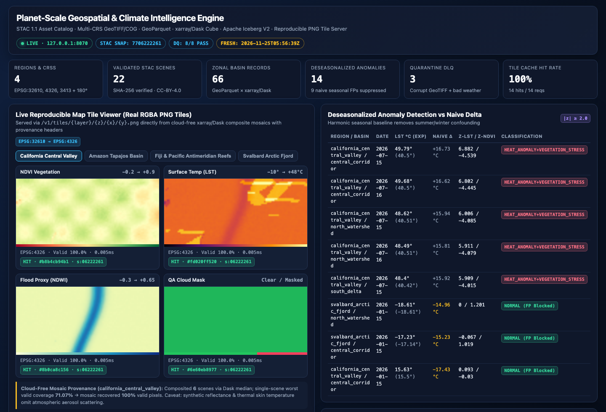

# Planet-Scale Geospatial & Climate Intelligence Engine

A scientific-scale geospatial data engineering platform that fuses multi-CRS satellite imagery (GeoTIFF/COG), ground weather station observations, and hydrological basin polygons (GeoParquet) into a versioned Apache Iceberg V2 lakehouse, xarray/Dask spatiotemporal climate cubes, deseasonalized anomaly analytics, and reproducible RGBA PNG map tiles.

**Headline Result:** On a single 14-core Apple M4 Pro workstation (Python 3.12.8, native GDAL/xarray/Dask/PyIceberg), the end-to-end pipeline ingests and harmonizes **22 multi-CRS STAC 1.1 scenes across 4 biomes** (`EPSG:32610`, `EPSG:4326`, `EPSG:3413`, plus `180°` antimeridian Pacific) in **742.6 ms** (`128×128` local profile, **2.91M band-pixels/sec**), recovers **100.0%** valid mosaic coverage from a **18.73%** valid heavy-cloud scene, passes **8/8** data quality gates and **8/8** chaos drills, speeds up Iceberg V2 Gold table scans by **9.33×** after Parquet compaction (`25 -> 1` file), and serves cached 256×256 RGBA PNG map tiles **209.7× faster** from disk (`0.179 ms` vs `37.60 ms` cold) and **9,895.6× faster** from memory (`0.0038 ms` vs `37.60 ms` cold).



## Architecture, Scientific Stack & Hardware

- **Domain & Precision:** Deterministic 6-band `float32` satellite scenes (`red`, `green`, `nir`, `swir`, `lst_k`, `qa_mask`) across 4 study regions (`california_central_valley` in UTM `EPSG:32610`, `amazon_tapajos_basin` in `EPSG:4326`, `fiji_pacific_atoll` crossing the `180°` antimeridian, and `svalbard_arctic_fjord` in Polar Stereographic `EPSG:3413`), fused with Avro v1/v2 ground weather observations and GeoParquet v1.1.0 basin polygons.
- **Core Stack (Verified Local & Distributed):** `rasterio==1.5.2` (GDAL `3.12.2`), `shapely==2.2.0`, `pyproj==3.8.0`, `xarray==2026.9.0`, `dask==2026.8.0`, `pystac==1.16.0`, `pyiceberg==0.12.0` (Apache Iceberg V2), `duckdb==2.0.0`, `pyarrow==25.0.1`, `fastavro==1.13.1`, `fastapi==0.163.2`, `uvicorn==0.54.0`. Distributed stack templates include Apache Sedona `1.9.1`, Spark `4.1.4`, Trino `484`, Airflow `3.4.0`, RustFS `1.0.6`, Lakekeeper `v0.15.1`, PostGIS `17-3.6.1`, Prometheus, Grafana, Loki, OpenTelemetry, and Marquez.
- **Measured Benchmark Hardware:** macOS `Darwin 24.6.0` (`arm64`), Apple M4 Pro (14 CPU cores, 48 GiB RAM), single-node local SSD. No external cloud services or pretrained ML weights required.

## Main Measured Results

### End-to-End Pipeline Profiles (22 Validated Scenes × 6 Bands)

| Profile | Scene Grid | Total Band-Pixels | CRS Reproject (ms) | Cube + Zonal (ms) | Total Wall Time (ms) | Throughput (Band-Px/s) | DQ Gate |
| --- | --- | ---: | ---: | ---: | ---: | ---: | :---: |
| `smoke` | `64×64` | 540,672 | 157.23 | 76.81 | **515.82** | 1,048,180 | 8/8 PASS |
| `local` | `128×128` | 2,162,688 | 328.49 | 117.34 | **742.60** | 2,912,319 | 8/8 PASS |
| `stress` | `256×256` | 8,650,752 | 1,019.54 | 302.30 | **2,154.65** | **4,014,922** | 8/8 PASS |

*Source: Raw outputs in [results/benchmarks/benchmark_summary.json](results/benchmarks/benchmark_summary.json) and [results/benchmarks/profiles.csv](results/benchmarks/profiles.csv). Total wall time includes Iceberg SQL catalog initialization and summary write overhead beyond the five listed stages.*

### Optimization & Serving Speedups (Measured Before vs. After)

| Optimization | Baseline (Unoptimized) | Optimized Result | Measured Improvement | Correctness Parity |
| --- | --- | --- | --- | --- |
| **PNG Map Tile Cache (Memory)** | `37.60 ms` p50 cold GDAL+PNG render (`MISS`) | **`0.0038 ms`** p50 in-memory cache (`HIT`) | **9,895.6× faster** vs. cold render | Identical SHA-256 `ETag` |
| **PNG Map Tile Cache (Disk)** | `37.60 ms` p50 cold GDAL+PNG render (`MISS`) | **`0.179 ms`** p50 disk-backed cache (`HIT`) | **209.7× faster** vs. cold render | Survives cold API restart |
| **Iceberg V2 Compaction** | `29.42 ms` p50 scan (`25` fragmented Parquet files) | **`3.15 ms`** p50 scan (`1` compacted file) | **9.33× faster** vs. uncompacted table | `354 / 354` rows preserved |
| **Dask Spatial Chunking (256²×6)** | `184.91 ms` median (`16px`, 1,536 partitions) | **`40.84 ms`** median (`256px`, 6 partitions) | **4.53× faster** vs. over-chunked `16px` | `0.0` NDVI parity delta |
| **Cloud-Free Mosaic Fallback** | `18.73%` valid px (worst single Amazon scene) | **`100.0%`** valid px (multi-date Dask median) | **+81.27 pp** coverage recovery | Zero cloud-top LST leak |

### Verification, Chaos & Governance Summary

- **Tests & Property Invariants:** **32/32 passing** (`pytest`), including 5 Hypothesis property tests (NDVI strictly in `[-1, 1]`, antimeridian polygons strictly in `[-180, 180]`, cloud/nodata thermal isolation, UTM & Polar CRS round-trip error `< 0.05 m`), Avro v1->v2 contract evolution, STAC 1.1 validation, and FastAPI RBAC (`401`/`403` enforcement).
- **Chaos & Fault-Injection Drills:** **8/8 passing** ([results/chaos/chaos_results.json](results/chaos/chaos_results.json)) covering corrupt GeoTIFF quarantine, mixed CRS normalization, 80% cloud-cover fallback, 180° antimeridian & 78°N polar boundaries, partial tile failure isolation, incremental backfill parity, v2 tile cache invalidation, and cold service restart recovery.
- **Seasonal Confounding Control:** Deseasonalized robust MAD z-score detection identifies **14** true heatwave, drought-stress, and flood-surge events while suppressing **9** false-positive winter/summer alarms triggered by naive annual-mean deltas.

## Models, Datasets & License Compliance

No pretrained ML weights are downloaded or served; all computations are deterministic physical and statistical geospatial algorithms.

| Asset / Dependency Group | License | Usage Restrictions | Audit Record |
| --- | --- | --- | --- |
| Project Source Code | Apache-2.0 | None | [LICENSE](LICENSE) |
| Synthetic Multi-CRS GeoTIFFs, Weather & GeoParquet Basins | CC-BY-4.0 (locally generated) | None | [results/sbom/license_audit.json](results/sbom/license_audit.json) |
| Core Geospatial & Lakehouse Wheels (18 audited packages) | Apache-2.0 / MIT / BSD-3-Clause / PSF | Zero copyleft or commercial restrictions | [results/sbom/sbom-cyclonedx.json](results/sbom/sbom-cyclonedx.json) |

## Run on Any Machine

### Option 1: Zero-Docker Native Python 3.12 (Recommended for macOS ARM64 & Linux)

```bash
git clone https://github.com/rohanluniya/geospatial-climate-intelligence.git
cd geospatial-climate-intelligence

# One-command setup, Bronze->Silver->Gold pipeline run, and live API + Control Tower on :8070
./scripts/run_portable.sh
```

Or run step-by-step via `Makefile`:

```bash
make setup        # Install pinned Python 3.12 geospatial dependencies via uv
make pipeline     # Generate GeoTIFFs/GeoParquet/STAC, build Iceberg V2 lakehouse, warm tiles
make serve        # Start FastAPI Spatial & Tile API + Control Tower at http://127.0.0.1:8070
```

Verify the running service:

```bash
# 1. Health & Prometheus metrics
curl -s http://127.0.0.1:8070/health | python3 -m json.tool
curl -s http://127.0.0.1:8070/metrics | head -n 15

# 2. Verify RBAC blocks unauthenticated requests (401) and viewer backfill (403)
curl -s -o /dev/null -w "unauth=%{http_code}\n" http://127.0.0.1:8070/v1/overview
curl -s -o /dev/null -w "viewer_backfill=%{http_code}\n" -X POST \
  -H "X-API-Key: dev-viewer-token-geo08" -H "Content-Type: application/json" \
  -d '{"region_id":"california_central_valley"}' http://127.0.0.1:8070/v1/backfill

# 3. Fetch a live RGBA PNG map tile and inspect provenance headers
curl -s -D - -o /tmp/california_ndvi.png \
  -H "X-API-Key: dev-viewer-token-geo08" \
  "http://127.0.0.1:8070/v1/tiles/ndvi/0/0/0.png?region_id=california_central_valley" | grep -iE "^(HTTP|etag|x-)"
```

### Option 2: Single-Container Docker Standalone

```bash
docker compose -f docker-compose.standalone.yml up --build
```

### Option 3: Multi-Profile Distributed Stack (Docker Compose)

```bash
# Core storage + catalog + API (RustFS, PostGIS, Lakekeeper, Geo API)
docker compose --profile core up -d

# Full distributed analytics + observability (Sedona, Spark, Trino, Airflow, Prometheus, Grafana, Loki, OTel, Marquez)
docker compose --profile full up -d
```

### Reproduce Tests, Chaos Drills & Benchmarks

```bash
make test         # Unit, Hypothesis property, Avro/STAC contract, integration, E2E & smoke tests
make chaos        # 8 automated fault-injection drills -> results/chaos/chaos_results.json
make benchmark    # Profiles, Dask chunk ablation, tile cache & Iceberg compaction -> results/benchmarks/
make all-checks   # Ruff lint, Mypy, static pinned-tag audit, license audit, SBOM, tests & chaos
```

## Detailed Analysis, Artifacts & Documentation

- **[APPENDIX.md](APPENDIX.md):** Complete Dask chunk-size ablation, tile cache & compaction breakdowns, 8 chaos drill records, benchmark charts, full-page dashboard capture, and the 15/15 acceptance-test matrix.
- **[results/](results/):** Raw measured outputs (`benchmarks/`, `chaos/`, `dq/`, `tests/junit.xml`, `sbom/`).
- **[docs/](docs/):** [System Architecture](docs/architecture/system-architecture.md), [ADRs](docs/architecture/), [Compatibility Matrix](docs/compatibility.md), [Benchmark Report](docs/benchmarks/benchmark-report.md), [Threat Model](docs/threat-model.md), [Incident Report INC-001](docs/incidents/inc-001-corrupt-geotiff-and-cloud-outage.md), [Operator Runbook](docs/incidents/runbook-geospatial-pipeline.md), [Engineering Case Study](docs/engineering-case-study.md), [Interview Deep Dive](docs/interview-deep-dive.md), [Limitations](docs/limitations.md), and [Demo Script](docs/demo-script.md).
