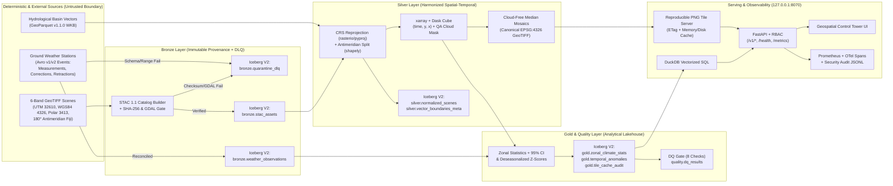
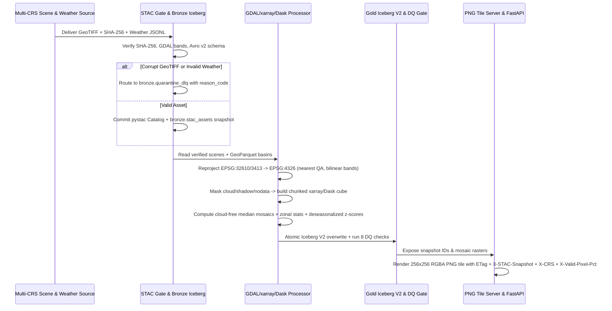

# System Architecture — Geospatial & Climate Intelligence Engine

## Component & Failure-Domain Diagram

## Core Workflow Sequence (Ingestion -> Mosaic -> Zonal Stats -> Versioned Tile Serving)

## Table Grain, Keys & Partitioning Model

| Iceberg V2 Table | Grain | Primary / Natural Key | Temporal Semantics | Maintenance |
| --- | --- | --- | --- | --- |
| `bronze.stac_assets` | 1 row per validated satellite scene version | `(scene_id, sha256)` | `acquisition_time_utc` vs `ingest_time_utc` | Append/dedup, snapshot audit |
| `bronze.weather_observations` | 1 active row per station & date | `(station_id, event_date)` | Latest `ingest_time_utc` wins (`CORRECTION` / `RETRACTION`) | Deduplicated active state |
| `bronze.quarantine_dlq` | 1 row per rejected source record | `(record_id, reason_code, quarantined_at_utc)` | Processing time (`quarantined_at_utc`) | Immutable audit trail |
| `silver.normalized_scenes` | 1 row per canonicalized scene | `scene_id` | Acquisition date + processing timestamp | Reproject provenance |
| `silver.vector_boundaries_meta` | 1 row per GeoParquet basin polygon | `basin_id` | Static versioned boundary metadata | Points to GeoParquet v1.1.0 |
| `gold.zonal_climate_stats` | 1 row per `(basin_id, scene_id)` | `zonal_id` | `acquisition_date` | Supports time travel & compaction |
| `gold.temporal_anomalies` | 1 row per evaluated `(basin_id, scene_id)` | `anomaly_id` | `acquisition_date` deseasonalized | Compared vs naive delta |
| `gold.tile_cache_audit` | 1 row per cold tile render event | `tile_key` | `served_at_utc` | Tracks ETag + snapshot lineage |
| `quality.dq_results` | 1 row per `(run_id, check_name)` | `dq_id` | `evaluated_at_utc` | Feeds Prometheus gauges |
