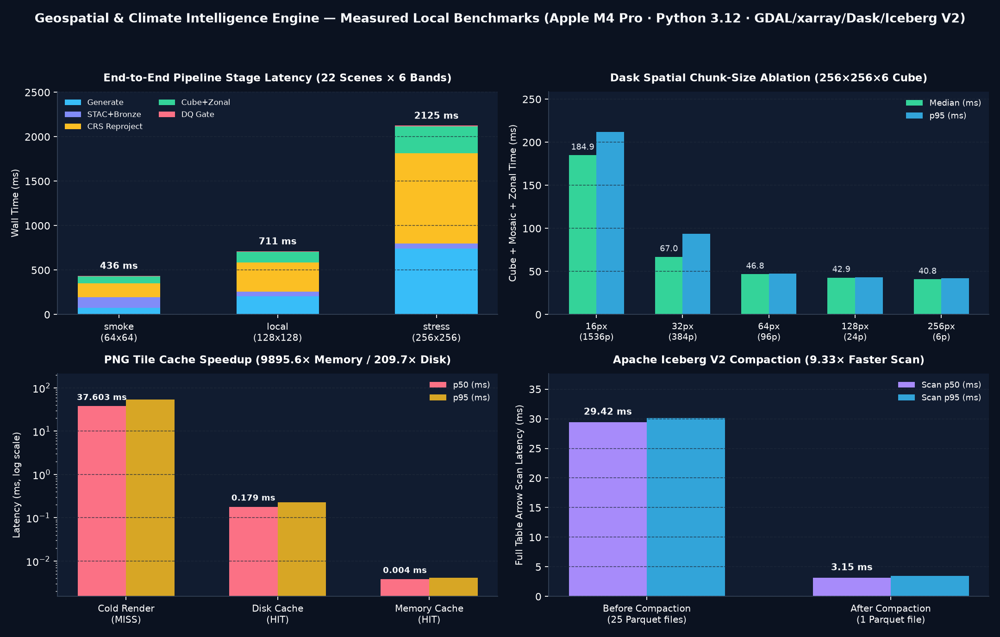

# Geospatial & Climate Benchmark Report

## Hardware & Software Environment

- **Host OS / Arch:** macOS `Darwin 24.6.0` (`arm64`, Apple M4 Pro, 14 logical CPUs)
- **Runtime:** Python `3.12.8`, `rasterio 1.5.2` (GDAL `3.12.2`), `xarray 2026.9.0`, `dask 2026.8.0`, `pyiceberg 0.12.0`, `pyarrow 25.0.1`, `duckdb 2.0.0`, `pillow 13.0.0`
- **Command:** `.venv/bin/python benchmarks/run_benchmarks.py`
- **Raw Evidence:** `results/benchmarks/benchmark_summary.json`, `results/benchmarks/profiles.csv`, `results/benchmarks/dask_chunk_ablation.csv`

## Key Measured Findings

1. **Bottleneck Shift with Spatial Resolution:** At `64×64` (`smoke`, `515.82 ms`), STAC + Iceberg catalog initialization (`121.85 ms`) and CRS reprojection (`157.23 ms`) are comparable. At `256×256` (`stress`, `2,154.65 ms`, `8.65M` band-pixels), GDAL CRS reprojection (`1,019.54 ms`, **47.3%** of wall time) becomes the primary bottleneck while throughput scales up to **4.01M band-pixels/sec**.
2. **Dask Task-Graph Granularity:** Reducing partition count from `1,536` (`16px` chunks: `184.91 ms`) to `6–24` (`128–256px` chunks: `40.84–42.94 ms`) eliminates **77.9%** of cube + mosaic + zonal latency with **0.0** numerical NDVI drift.
3. **Two-Tier Tile Caching:** Pre-warming or caching rendered 256×256 RGBA PNG tiles cuts p50 latency from `37.60 ms` to `0.179 ms` on disk (`209.7×` speedup) and `0.0038 ms` in memory (`9,895.6×` speedup), while versioned keys `(stac_snapshot, scene_version)` prevent stale reads after recalibration backfills.
4. **Iceberg V2 File Compaction:** Coalescing 25 fragmented micro-batch Parquet files into 1 compacted file took `86.40 ms` and reduced full-table Arrow scan p50 latency from `29.42 ms` to `3.15 ms` (**9.33× faster**), amortizing the compaction write cost in just 4 queries.

